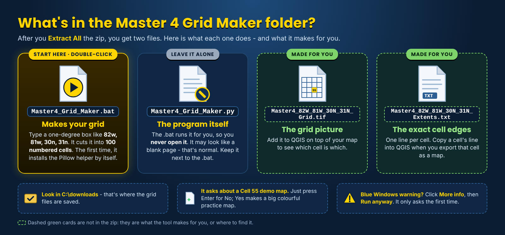
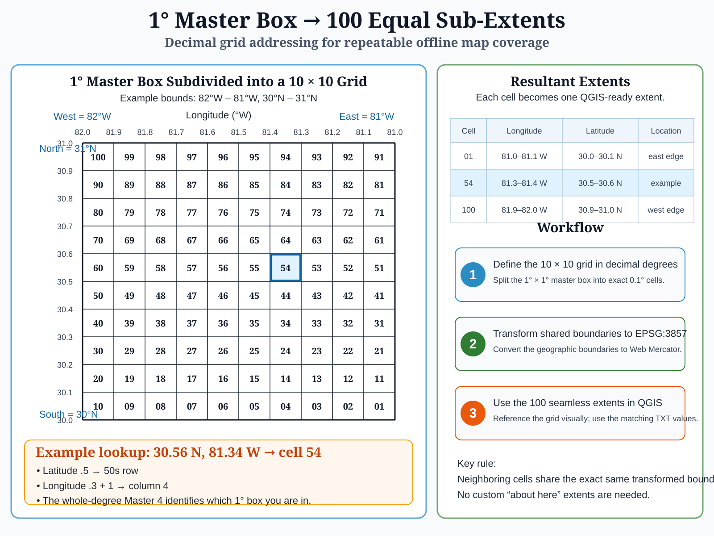

# Master 4 Grid Maker 2.0

<!-- install-blurb:start -->
> ### Installing Master 4 Grid Maker - read this first
>
> 1. **Extract All first:** right-click the downloaded zip > **Extract All**, then open the new folder. (Double-clicking files while they are still inside the zip does not work.)
> 2. **Double-click `Master4_Grid_Maker.bat`** - the only .bat in the folder. This manual sits right next to it. The **System Files** folder holds the program - leave it alone.
> 3. **Blue "Windows protected your PC" box?** Click **More info**, then **Run anyway**. It only asks the first time. (Or, before extracting: right-click the zip > **Properties** > tick **Unblock** > **OK**.)
> 4. **Python - nothing to install by hand.** If Python is missing, the window asks **Install Python now? [Y/N]**: type **Y** and press Enter. It installs just for you (no admin needed) - and the Pillow picture library too. On an older PC this can take several minutes and Windows Defender may make the PC look frozen - **do not close the window**.
> 5. Its files are saved in `C:\downloads`.
>
> Something stops it? The window says what to do in plain words, and keeps a log in `System Files\Ready_To_Fly_log.txt`. On a work computer that blocks installs, ask IT to install Python 3 from python.org.
<!-- install-blurb:end -->


**2.0 (2026-11-08):** the whole ArcGIS Earth Unlocked family moved to 2.0 as one reference point. The zip holds a `Master4_Grid_Maker_v2.0` folder; the program is v3.1 and the console says `Master 4 Grid Maker v2.0`. Grid output unchanged.

**v3.1.2 (2026-11-06):** a tidy folder - the zip holds a `Master4_Grid_Maker_v3.1.2` folder with `Master4_Grid_Maker.bat` (double-click this) and `System Files` (the program). Program and output unchanged.

**v3.1.1 (2026-11-02):** launcher update only. `Master4_Grid_Maker.bat` installs Pillow automatically the first time if it is missing, and finds Python through `py -3` or `python`. The program and its output are unchanged from v3.1.

**v3.1 (2026-10-31)** is a hardening release: a typo now asks again instead of closing, `82.0w`/`082w` are accepted as `82w`, an interrupted demo build leaves nothing behind, and the TXT/TIF pair is replaced together. Grid output is identical to v3. See [MASTER4_V3.1_CHANGES.md](MASTER4_V3.1_CHANGES.md).

**Master 4 Grid Maker** is a companion utility for manufacturing repeatable offline-map coverage. Give it the four whole-degree edges of one 1-degree x 1-degree geographic master box and it creates:

1. a numbered 100-cell EPSG:3857 GeoTIFF reference overlay;
2. a production manifest with exact QGIS-ready cell extents and deterministic TPKX filenames;
3. one final `MASTER` row containing the exact EPSG:3857 extent of the entire 1-degree box; and
4. **optionally**, a synthetic Cell 55 TPKX containing colored Z10-Z20 tiles for teaching, TPKX sanity checks, and offline geographic/zoom reference.

## Download

**[Download Master4_Grid_Maker.zip](Master4_Grid_Maker.zip)**  
**[Open the printable 2.0 manual (PDF)](Master4_Grid_Maker_User_Manual.pdf)** - this page as a PDF

Right-click the ZIP > **Extract All**. The folder holds just three things - keep them together:

```text
Master4_Grid_Maker.bat
Master4_Grid_Maker_User_Manual.pdf   (this manual)
System Files\      (the program - leave it alone)
```

Requirements:

- Windows
- Python 3 and Pillow - `Master4_Grid_Maker.bat` installs both for you if they are missing (answer **Y**; no admin needed)
- Pillow

Pillow installs automatically the first time you run `Master4_Grid_Maker.bat` (internet needed once). To install it by hand:

```powershell
py -3 -m pip install Pillow
```

## What's in the zip



## Input

Double-click `Master4_Grid_Maker.bat`. At the prompt `Enter Master 4 (blank to quit):`, type the Master 4 in this exact order:

```text
west longitude, east longitude, south latitude, north latitude
```

Example:

```text
82w, 81w, 30n, 31n
```

The four edges must be whole degrees and must describe exactly one 1-degree x 1-degree box. East and south work the same way, for example `10e, 11e, 30n, 31n` or `82w, 81w, 31s, 30s`.

If an entry is invalid, the program explains why and asks again. Press Enter on a blank line to quit.

## Standard output

The program always creates the normal Master 4 outputs first, in `C:\downloads` (created if it does not exist). It prints their full paths under `Created:`. For the example above:

```text
C:\downloads\Master4_82W_81W_30N_31N_Extents.txt
C:\downloads\Master4_82W_81W_30N_31N_Grid.tif
```

### Production manifest

The TXT contains **100 numbered production rows plus one final `MASTER` row**.

Each numbered row contains:

```text
cell xmin,xmax,ymin,ymax [EPSG:3857] deterministic-filename.tpkx
```

Example:

```text
01 -9028010.7033,-9016878.7543,3503549.8435,3516410.3983 [EPSG:3857] W082W081N031N030-001-GHY-Z20.tpkx
```

The final line records the full Master 4 extent:

```text
MASTER -9128198.2450,-9016878.7543,3503549.8435,3632749.1434 [EPSG:3857]
```

Running the same Master 4 again replaces its TXT and TIF together; a file that is open in another program is reported instead of half-replaced.

This gives the operator both levels of the system in one file: **100 exact production cells + the exact 1-degree parent box**.

### Deterministic production filename

The current filename pattern is:

```text
W082W081N031N030-055-GHY-Z20.tpkx
```

It encodes the Master 4 **west edge, east edge, north edge, south edge**, followed by the three-digit cell number and current fixed production suffix `GHY-Z20`.

The filename is attached to the same manifest row as the exact extent. Cells can therefore be produced in any order without depending on sequential batch naming.

### Numbered GeoTIFF overlay

The generated GeoTIFF is a 5000 x 5000 EPSG:3857 reference overlay with labels 01-100. Its background is tagged as NoData so the underlying map can remain visible in viewers that honor the NoData value.

**Permanent operating rule:** reference overlays **ON while planning; OFF before production**. If the numbered overlay is left visible during raster production, it can be burned into the finished map imagery.

## The 01-100 addressing system

Every Master 4 box is subdivided into 100 geographic cells, each exactly **0.1 degree longitude x 0.1 degree latitude** before projection.

The cell number is designed so a latitude/longitude can reveal its sub-cell quickly:

- first decimal digit of the **absolute latitude** = tens row;
- first decimal digit of the **absolute longitude**, plus 1 = column.

Truncate the decimal digits; do not round.

Examples:

```text
30.56N, 81.34W -> 54
30.56N, 10.34E -> 54
30.56S, 81.34W -> 54
30.56S, 10.34E -> 54
```

The numbering reverses physical direction as needed in different hemispheres so the decimal lookup remains consistent.



## Why the EPSG:3857 boundaries are calculated from geographic tenths

The system is defined geographically at exact tenth-degree boundaries. The program determines those shared geographic edges first, then transforms each edge with the Web Mercator equations into EPSG:3857.

It does **not** simply divide the projected Y distance into ten equal parts. Web Mercator Y is nonlinear with latitude, so doing that would not land on exact 0.1-degree latitude boundaries.


## Optional v3 Cell 55 colored TPKX

After the TXT and GeoTIFF are already complete, v3 asks:

```text
Create Cell 55 colored zoom-demo TPKX (Z10-Z20)? [y/N]:
```

### The operator can opt out

**No is the default.** Press Enter, type `N`, or type anything other than `Y`/`Yes` and the program ends normally without creating the large demo TPKX.

The standard Master 4 outputs are not dependent on this choice.

If the operator answers `Y` or `Yes`, the program prints one line per finished zoom level and creates a file in `C:\downloads` such as:

```text
W082W081N031N030-055-ZOOM-DEMO.tpkx
```

### What is inside

The package contains synthetic raster tiles for **Z10 through Z20**. Each zoom has a different color and each tile is labeled with the zoom number plus `CELL 55`.

The project owner generated the current v3 package on Windows and opened it successfully in ArcGIS Earth. User-supplied screenshots showed visible transitions at several levels including Z12, Z13, Z14, Z15, Z17 and Z20.

The owner reported a current package of roughly **1 GB**. The file is deliberately large because it fills every global XYZ tile intersecting Cell 55 at all stored levels Z10-Z20. File size varies with latitude and PNG compression.

### Important coarse-zoom behavior

At low zoom levels, a standard 256 x 256 XYZ tile covers much more ground than one 0.1-degree Master 4 cell. Therefore the visible colored tile footprint can extend beyond the exact Cell 55 boundary.

That is expected. The demo package is a **geographic sanity check and zoom-level teaching/reference tool**. The exact production boundary still comes from the Master 4 GeoTIFF and manifest.

## Why the demo TPKX is useful

### 1. Give a new user a TPKX win immediately

A user can create and open a real TPKX in ArcGIS Earth before touching QGIS. This proves the viewer can read a local multiresolution TPKX and gives the user immediate feedback instead of asking them to complete a full production workflow first.

### 2. Make the tile pyramid visible

A normal map hides its internal zoom pyramid. The synthetic package makes it obvious: when ArcGIS Earth changes stored raster levels, the color and giant Z-number change.

### 3. Quick Master 4 sanity check before QGIS

The optional package is generated from the same Master 4 box and Cell 55 calculations. Opening it in ArcGIS Earth gives a fast check that the home grid and TPKX geography are in the expected neighborhood before committing to high-resolution production.

### 4. Offline reference beacon

When ArcGIS Earth is offline and the normal online basemap is unavailable, the screen can lose familiar geographic context. Opening the local Cell 55 demo package gives the operator:

- a known geographic anchor in the home Master 4;
- strong visual structure even with no online basemap;
- visible Z10-Z20 zoom-level awareness;
- a fast confirmation that local TPKX loading still works.

This is a reference convenience, not a replacement for a real offline basemap or authoritative operational map.

## Recommended ArcGIS Earth operating flow

1. Keep area-wide **Z17 overview TPKX** map(s) enabled for broad context.
2. When an area of interest appears, enable the Master 4 numbered GeoTIFF overlay.
3. Identify the required cell or adjacent cells.
4. Read the matching manifest rows for exact extents and filenames.
5. Optionally create/open the Cell 55 color TPKX as a quick TPKX/geographic sanity check.
6. Go to QGIS only after you know which high-resolution cells you actually need.
7. Produce those cells, create compatible raster MBTiles, convert them to TPKX, and load them into ArcGIS Earth.

The logic is simple:

**Z17 overview -> grid overlay -> choose cells -> optional TPKX proof -> QGIS production -> high-resolution TPKX coverage**

## Typical QGIS workflow

1. Run Master 4 Grid Maker for the 1-degree master box covering the area.
2. Add the generated `_Grid.tif` to QGIS as a reference overlay.
3. Identify the numbered cell(s) covering the work area.
4. Copy the exact extent from the matching `_Extents.txt` row.
5. Use the deterministic filename from that row.
6. **Turn the reference overlay OFF before raster production.**
7. Create compatible raster MBTiles.
8. Convert MBTiles to TPKX with `mb2tpkx.py` when ArcGIS Earth is the target viewer.

## Validation performed

The standard Master 4 outputs were regression-tested on representative W/N, E/N, W/S and E/S boxes plus boundary cases. The v3 addition was built so the existing TXT/GeoTIFF behavior remains the production baseline and the synthetic TPKX is opt-in.

The v3 Cell 55 package was structurally checked before delivery, then generated by the project owner on Windows and opened successfully in ArcGIS Earth. That field test is the acceptance evidence for the exact v3 teaching package behavior described here.

The program does not overwrite an existing demo TPKX; move, rename or delete an old demo before intentionally regenerating the same output name.

v3.1 was regression-tested byte-for-byte against v3 and live-accepted in ArcGIS Earth; see [MASTER4_V3.1_CHANGES.md](MASTER4_V3.1_CHANGES.md).

## Geographic scope

The Master 4 production system is intended for Web Mercator workflows. Physical ground area changes with latitude because the grid is geographic. See [TECHNICAL.md](TECHNICAL.md) for projection/format details.

## Current file checksums (2.0)

Every file's SHA-256 in the 2.0 Reference is listed on one page: [REFERENCE_2.0.md](https://github.com/Jim-dc95811/ArcGIS-Earth-Unlocked/blob/main/REFERENCE_2.0.md). The program is v3.1 with only its version line changed.

The project [MIT License](LICENSE) applies to the software. Source-imagery rights remain separate. The synthetic color demo does not download or redistribute third-party imagery.
