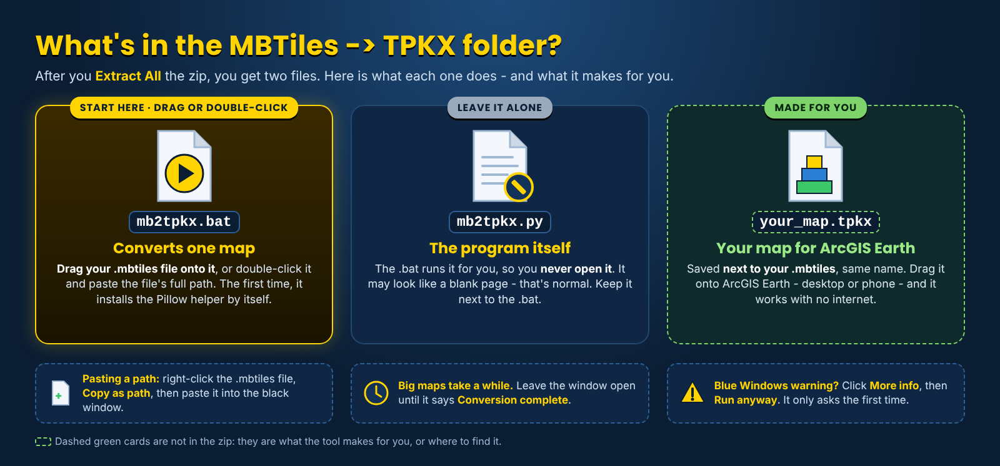

# MBTiles to TPKX Converter 2.1 - User Manual

<!-- install-blurb:start -->
> ### Installing the MBTiles to TPKX Converter - read this first
>
> 1. **Open the tool's folder.** Easiest is **Google Drive** (the link at the top of the project page): the folder is already unpacked - just open it, nothing to extract. If instead you downloaded the **zip** from GitHub, right-click it > **Extract All** first, then open the new folder. (Double-clicking files while they are still inside a zip does not work.)
> 2. **Double-click `mb2tpkx.bat`** - the only .bat in the folder. This manual sits right next to it. The **System Files** folder holds the program - leave it alone.
> 3. **Blue "Windows protected your PC" box?** Click **More info**, then **Run anyway**. It only asks the first time. (Or, before extracting: right-click the zip > **Properties** > tick **Unblock** > **OK**.)
> 4. **Python - nothing to install by hand.** If Python is missing, the window asks **Install Python now? [Y/N]**: type **Y** and press Enter. It installs just for you (no admin needed) - and the Pillow picture library too. On an older PC this can take several minutes and Windows Defender may make the PC look frozen - **do not close the window**.
> 5. An MBTiles map file to convert (for example one made in QGIS).
> 6. To open the TPKX it makes you need **ArcGIS Earth** (free from Esri: https://www.esri.com/en-us/arcgis/products/arcgis-earth/downloads).
>
> Something stops it? The window says what to do in plain words, and keeps a log in `System Files\Ready_To_Fly_log.txt`. On a work computer that blocks installs, ask IT to install Python 3 from python.org.
<!-- install-blurb:end -->


A printable copy of this manual is available as [mb2tpkx_User_Manual.pdf](mb2tpkx_User_Manual.pdf).

## Purpose

Convert an existing raster MBTiles file directly to a native Esri TPKX for offline viewing in ArcGIS Earth. ArcGIS Earth cannot open MBTiles itself; it can open the converted TPKX.

Source PNG/JPEG map tiles are copied unchanged. The converter does not download imagery and does not rebuild or add zoom levels.

## Requirements

- Windows
- Python 3 and Pillow - `mb2tpkx.bat` installs both for you if they are missing (answer **Y**; no admin needed)
- Pillow (one extra Python library; `mb2tpkx.bat` installs it automatically the first time, since v1.1.1)
- An existing compatible raster MBTiles file

The first time you run `mb2tpkx.bat` without Pillow, it says `Pillow is not installed yet. Installing it now - one time only...`, installs it (internet needed once) and carries on. If your network blocks the download, it prints the command to give to IT. To check Python and install Pillow by hand from a Command Prompt:

```text
py -3 --version
py -3 -m pip install Pillow
```

## Get the converter

1. Download [`mb2tpkx.zip`](mb2tpkx.zip).
2. Right-click it > **Extract All**. You get a `mb2tpkx_v2.1` folder holding just `mb2tpkx.bat`, this manual as a PDF (`mb2tpkx_User_Manual.pdf`) and `System Files` (the program - leave it alone).
3. Keep the two together.

## What's in the zip



## Run it

1. Drag your `.mbtiles` file onto `mb2tpkx.bat`, or double-click the BAT and paste the full path when asked:

   ```text
   Enter the full path to your MBTiles file:
   ```

2. The console shows `mb2tpkx 2.1`, then one line per finished tile bundle with how far along it is, for example `bundle 812 of 4,630 (17%) - z20 tile/L20/R69480C45b00.bundle`.
   If a TPKX with the same name is already there, it first asks `Replace it? [y/N]`: **Y** builds over it, **N** (or just Enter) keeps the old one.
3. Wait for the `SUCCESS` line, for example:

   ```text
   SUCCESS: 6461 original tiles, 14 bundles -> C:\Maps\bryceville_7_layer_mbtile.tpkx
   ```

   The window then shows `Conversion complete.` and waits for a key press.
4. The TPKX is created beside the MBTiles with the same base name. The MBTiles is not changed.
5. Open the TPKX in ArcGIS Earth and check the map.

## Command line

From the `System Files` folder:

```text
py -3 mb2tpkx.py "input.mbtiles" "output.tpkx"
```

If the output name is left out, the input name is reused with `.tpkx`.

## Supported input

Standard Web Mercator raster MBTiles with 256 x 256 PNG or JPEG tiles, TMS tile rows, zoom levels 0-23. QGIS is one way to make them; the converter does not require QGIS. Vector MBTiles and other projections are outside the verified scope.

## What it does

1. Reads the MBTiles database.
2. Converts its TMS tile rows to Esri XYZ rows.
3. Groups the tiles into 128 x 128 Compact Cache V2 bundles.
4. Writes the TPKX metadata.
5. Copies every source tile byte for byte.

Only a separate presentation thumbnail is generated.

## Safe output

- An existing TPKX is only replaced when you answer **Y** to `Replace it? [y/N]`. If the old TPKX is open in ArcGIS Earth, it says so before doing any work.
- Disk space is checked first: if the drive is too full for the TPKX, it stops at once and says how much room is needed.
- The new TPKX is written as `<name>.tpkx.partial` and renamed only when the conversion has fully succeeded.
- If a conversion fails or is cancelled, the partial file is removed. Nothing needs cleaning up before you try again.

## Messages and what to do

Problems are reported as one plain `ERROR:` line, followed by `Conversion failed. Check the error above.`

| Message | What to do |
|---|---|
| `Pillow could not be installed automatically.` or `ERROR: Pillow is not installed...` | Run `py -3 -m pip install Pillow`, or ask IT if your network blocks downloads. |
| `Python 3.9 or newer is not installed.` | Answer **Y** to let the .bat install it for you. On a work computer that blocks it, ask IT to install Python 3 from python.org. |
| `MBTiles file not found` | Check the path, or drag the file onto the BAT. |
| `... already exists ... Replace it? [y/N]` | **Y** builds over the old TPKX; **N** keeps it (`Not converted - the existing TPKX was kept.`). |
| `Could not replace ... - it may be open in ArcGIS Earth` | Remove the TPKX from ArcGIS Earth (or close ArcGIS Earth) and run again. |
| `Not enough disk space: the TPKX needs about ...` | Free space on that drive, or move the MBTiles to a drive with more room. |
| `Tile z.. (..) is empty - the MBTiles is damaged.` | Make the MBTiles again in QGIS. |
| `Input and output paths cannot be the same.` | Give the output a `.tpkx` name. |
| `MBTiles has no imagery tiles.` | The MBTiles is empty; rebuild it in QGIS. |
| `Could not read ... as an MBTiles database` | The file is damaged or not an MBTiles file. |
| `Only 256 x 256 PNG/JPEG MBTiles are supported...` or `Unsupported image format` | Rebuild the MBTiles with 256-pixel PNG or JPEG tiles. |
| `A tile is not a readable PNG/JPEG image.` | A tile in the MBTiles is damaged; rebuild it. |
| `Input zoom levels exceed the verified 0-23 Esri tiling scheme.` | Use zoom levels 0-23. |
| `File problem - ...` | Usually a full disk or a locked file; free space or close the program using it. |

## Large files

Allow enough time and free disk space (the converter checks the space before it starts): because the tiles are copied unchanged, the TPKX is roughly the same size as the MBTiles (a 97 MB Bryceville MBTiles became a 95 MB TPKX). 4 GB, 20+ GB and 40 GB-class packages have been converted and opened in ArcGIS Earth.

## QGIS workflow

1. Create the raster MBTiles in QGIS with your intended source, extent, zoom range and image format.
2. For large systematic coverage, use the [Master 4 Grid Maker](MASTER4_GRID_MAKER.md) for exact, repeatable extents and file names.
3. Convert each MBTiles with `mb2tpkx.bat`.
4. Check the resulting TPKX in ArcGIS Earth before field use.

## Quick reference

```text
Install:  automatic on first run (by hand: py -3 -m pip install Pillow)
Run:      drag input.mbtiles onto mb2tpkx.bat
Output:   input.tpkx beside input.mbtiles
```

The input MBTiles stays unchanged. An existing TPKX is protected from overwrite.

## Source rights

This utility does not grant rights to third-party imagery. Use only imagery you are authorized to acquire, retain, convert, display or redistribute. See [LEGAL.md](LEGAL.md).
