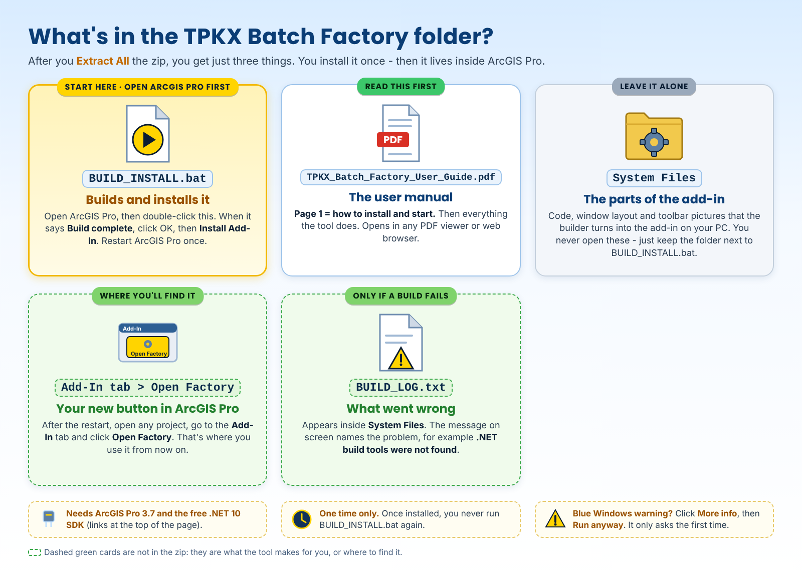

# ArcGIS TPKX Batch Factory 2.0

<!-- install-blurb:start -->
> ### Installing the Batch Factory - read this first
>
> 1. **Extract All first:** right-click the downloaded zip > **Extract All**, then open the new folder. (Double-clicking files while they are still inside the zip does not work.)
> 2. You need **ArcGIS Pro 3.7** (installed and licensed) and the free **Microsoft .NET 10 SDK** (https://dotnet.microsoft.com/en-us/download/dotnet/10.0). No Python needed.
> 3. **Open ArcGIS Pro first** and leave it running, then **double-click `BUILD_INSTALL.bat`** - the only .bat in the folder. This manual sits right next to it; the **System Files** folder holds the add-in's parts - leave it alone.
> 4. **Blue "Windows protected your PC" box?** Click **More info**, then **Run anyway**.
> 5. When it says **Build complete**, click **OK**, then **Install Add-In**. Restart ArcGIS Pro once: the Factory is on the **Add-In** tab as **Open Factory**.
>
> Something stops it? The message names the problem, and the details are in `System Files\BUILD_LOG.txt`. Full steps: *Install the add-in* below.
<!-- install-blurb:end -->

A printable copy of this guide is available as [TPKX_Batch_Factory_User_Guide.pdf](TPKX_Batch_Factory_User_Guide.pdf).

The Batch Factory is an ArcGIS Pro add-in that turns controlled **EPSG:3857 extents** into offline TPKX packages using ArcGIS Pro's native tile-cache export path.

## What the operator supplies

- Map product: **Satellite Imagery**, **Road Overlay**, or **Both**.
- Maximum zoom: **Z16, Z17, Z18, Z19, or Z20**.
- Destination folder (default `D:\New TPKX\ArcGIS`; use **Browse...** to choose another; it is created if needed).
- **1-10** canonical EPSG:3857 extent lines, normally rows from the [Master 4 Grid Maker](https://github.com/Jim-dc95811/QGIS-Mbtile-to-ArcGIS-Earth-TPKX/blob/main/MASTER4_GRID_MAKER.md) TXT file.

> **Pasting Master 4 rows into the Batch Factory:** delete the file name at the end of each row first. The Factory accepts `01 -9028010.7033,-9016878.7543,3503549.8435,3516410.3983 [EPSG:3857]` but rejects the same row with `W082W081N031N030-001-GHY-Z20.tpkx` still on the end.

## Install the add-in

The Factory is delivered as source code that builds itself into an ArcGIS Pro add-in on your computer.

You need:

- Windows with **ArcGIS Pro 3.7** installed and licensed in the standard location (`C:\Program Files\ArcGIS\Pro`).
- The **Microsoft .NET 10 SDK** (from Microsoft's .NET download page), installed in the standard location.
- Internet access while building TPKX files.

Steps:

1. **Open ArcGIS Pro first** and leave it running.
2. Download [`TPKX_Batch_Factory_v1.zip`](TPKX_Batch_Factory_v1.zip) and extract it to a normal folder. You get a `TPKX_Batch_Factory_v2.0` folder holding just `BUILD_INSTALL.bat`, this guide as a PDF, and `System Files` (the add-in's parts - leave them alone).
3. Double-click `BUILD_INSTALL.bat`. A small "Building ArcGIS TPKX Factory..." window appears.
4. When it says **Build complete**, click OK. The ArcGIS Add-In Installation Utility opens: click **Install Add-In**.
5. Restart ArcGIS Pro once. The Factory appears on the **Add-In** tab as **Open Factory** (group **TPKX Factory**).

If the build fails, a message names the problem (for example ".NET build tools were not found." or "ArcGIS Pro SDK build target was not found.") and the details are written to `BUILD_LOG.txt` inside `System Files` (since 2026-11-06). Nothing is installed after a failed build.

## What's in the zip



## Open the Factory

Open any ArcGIS Pro project, go to the **Add-In** tab and click **Open Factory**. The **ArcGIS TPKX Batch Factory** window opens; it can be moved and resized and stays open while you work.

The visible map in ArcGIS Pro is not the production map. The Factory creates private maps for preflight and production, keeping each job isolated.

## Before BUILD BATCH

1. Open ArcGIS Pro and launch the Factory add-in.
2. Keep internet access available during production; the Factory is building offline files but must retrieve the selected tiles while it runs.
3. Choose a destination with enough free space.
4. Paste 1-10 extent lines: type or paste one per row, or copy several lines and press **PASTE MULTIPLE EXTENTS** to fill the rows in order (only the first 10 are used). **CLEAR ROWS** empties all rows.
5. Choose the product and maximum zoom.
6. **Leave the destination folder alone once the batch starts.**

Do not rename, move, copy, add, or delete TPKX files in the destination during a run. The safety logic compares filenames before and after each job.

## Running a batch

1. Select the map product.
2. Select the maximum zoom.
3. Select the destination.
4. Paste the extents.
5. Press **BUILD BATCH**.
6. Watch the Job and Status indicators.

The Factory preflights all requested extents before starting production. If a row cannot be read, the status box shows `BATCH INPUT ERROR` with the row number. It does not silently lower an unsupported zoom: a zoom ArcGIS cannot export for an extent stops the batch before any file is made.

## Between jobs

Each extent is exported from a newly created private map. After every third completed job, if more jobs remain, the Factory waits **120 seconds** before starting the next group.

## Safe cancellation

**CANCEL BATCH** allows the current ArcGIS export to finish safely and then prevents the remaining jobs from starting.

## Outputs and protection

`<LABEL>` is the label at the start of each extent row (for a Master 4 row, the cell number such as `01`); a row without a label is named `JOB01`, `JOB02` and so on. Output names:

```text
World_Imagery Grid <LABEL>.tpkx
Reference_World_Transportation Grid <LABEL>.tpkx
```

If an expected output already exists, the batch does not start. Each run also writes a timestamped batch log, `ArcGIS_TPKX_Batch_<date>_<time>.txt`, to the destination folder.

For a single-product job the Factory expects exactly one new TPKX file; for **Both**, exactly two. A different count triggers a safety stop.

## After the batch

1. Confirm all intended jobs show PASS.
2. Verify the output files and names.
3. Rename only after the Factory is completely finished.
4. Archive the finished maps.
5. Experiment only on copies, not the archive originals.
